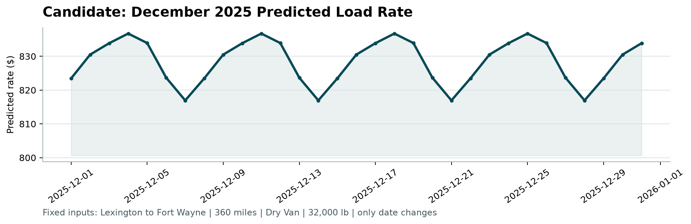

# Freight Rate Prediction: Report

## 1. Problem
Predict the truckload `posted_rate` (USD) for 12,000 unseen loads dated Nov–Dec 2025, using 48,000 labeled loads from Jan–Oct 2025. Also produce a 31-day December rate curve for one fixed lane (Lexington → Fort Wayne, 360 mi, Dry Van, 32,000 lb), where `market_index` and `quote_signal` are not given.

## 2. Data findings and cleaning

| Issue | Finding | Rule applied |
|---|---|---|
| Negative weight | 292 train / 145 validation rows, as low as −47,500. Their distribution mirrors the positive one (median −31.8k vs +31.4k). | Treated as a sign error: `abs(weight)`, clipped to the observed range [5,000, 47,500]. A `weight_was_negative` flag is kept as a feature. |
| Missing weight | 300 train / 165 validation rows | Filled with the equipment-level median from training data. A `weight_was_missing` flag is kept. |
| Missing market_index | 374 train / 249 validation rows | `market_index` behaves like a daily series (std within a day is 0.025, against 0.17 overall), so gaps are filled with the mean for the same date in the same file, then with a day-of-week mean. This uses features only, never labels. |
| Label anomalies | About 1.4% of rates are roughly 5× too high or too low for their distance and equipment (e.g. a 421-mile Reefer at $184). In October they make up **97% of the squared error**. | Rows whose rate is more than 2.5× off a robust in-sample fit are **dropped from training only**. Headline metrics are always computed on **all** holdout rows. A "clean" metric is reported separately. |
| Unseen cities | Validation has 8 cities that do not appear in training (e.g. Chicago, Laredo). | Geography is modeled with lat/lon, not city IDs, so these rows are handled. |
| Range shift | `market_index` drifts by regime (monthly mean 0.89 to 1.30). | See §4: the market features did not generalize forward. |

## 3. Validation design (time-based; no random split)
- **Model selection uses a rolling-origin backtest.** For each test month (August, September, October), the model is fit on all earlier months and scored on that month. The model with the lowest mean MAE across the three months is chosen.
- **Detailed holdout:** fit on 2025-01-01 → 2025-09-30, test on all of October 2025 (4,853 loads). Nothing is shuffled across dates.
- Early stopping uses another time-based split: the last 30 days of the fit window.
- The anomaly filter is fitted only on the fit window, so October labels never affect training.
- **Final model:** the same recipe refit on all of Jan–Oct, with the early-stopped tree count scaled ×1.1 for the extra data.

## 4. Features and model
- **Target:** `log(posted_rate)` with an **L1 (MAE) objective**. This makes errors relative and keeps the model robust to the bad labels.
- **Model:** LightGBM (63 leaves, learning rate 0.03, row/column subsampling, `seed=42`, deterministic). Training takes about 10 s on CPU.
- **Features:** distance and log(distance); equipment; weight with missing/negative flags; pickup and delivery lat/lon; Δlat and Δlon; circuity (road miles ÷ great-circle miles); lane bearing (sin/cos); day of week; weekend flag. Together, log-distance, equipment and the geography features let the trees learn the rate-per-mile structure, including its taper with distance.
- **Market features** were tested in two forms, and the backtest **rejected both**:
  - raw `market_index`, `quote_signal` and `market_index × log distance`
  - relative versions with the monthly drift removed: the day's index ÷ its trailing 28-day mean, and each load's quote ÷ that day's mean quote

  The raw level shifts from month to month, so the trees overfit the Jan–Sep pattern. The relative version ties on October but does clearly worse in August and September.

## 5. Rolling backtest (MAE in $, all rows)

| Model | Aug 2025 | Sep 2025 | Oct 2025 | **Mean** |
|---|---|---|---|---|
| Baseline: distance × median RPM by equipment | 241.2 | 227.3 | 231.4 | 233.3 |
| LightGBM + raw market features | 134.0 | 137.7 | 128.4 | 133.4 |
| LightGBM + relative market features | 137.5 | 112.3 | 101.5 | 117.1 |
| **LightGBM, no market features (selected)** | **95.8** | **98.3** | **102.3** | **98.8** |

The selected model wins or ties in every month, and its error is stable from month to month. Per-fold MAE, RMSE, MAPE and RPM RMSE are in `artifacts/backtest.csv`.

## 6. Detailed holdout metrics (October 2025, n = 4,853)

**All rows (headline):**

| Model | MAE ($) | RMSE ($) | MAPE | Median APE | RPM RMSE ($/mi) |
|---|---|---|---|---|---|
| Baseline: distance × median RPM by equipment | 231.4 | 683.9 | 10.93% | 6.73% | 0.62 |
| LightGBM + market features (actual values) | 128.4 | 655.7 | 5.92% | 2.61% | 0.57 |
| LightGBM + market features (imputed, i.e. the December path) | 135.1 | 654.4 | 6.52% | 3.23% | 0.58 |
| **LightGBM, no market features (selected)** | **102.3** | **647.6** | **4.83%** | **1.58%** | **0.56** |

**Excluding the 72 label anomalies in October:**

| Model | MAE ($) | RMSE ($) | MAPE | RPM RMSE |
|---|---|---|---|---|
| Baseline | 176.3 | 277.1 | 8.25% | 0.28 |
| **Selected LightGBM** | **45.1** | **118.0** | **2.03%** | **0.11** |

The selected model cuts MAE by **56%** against the baseline (74% on clean rows). RMSE on all rows is dominated by the 1.5% of corrupted labels, which no model can predict. That is why both views are reported. Full per-row holdout predictions are in `artifacts/holdout_report.csv`, and all numbers are in `artifacts/metrics.json`.

## 7. December prediction without market features
The selection logic compared the two paths that are possible without December market data:
1. the market model with `market_index`/`quote_signal` **imputed from history** (recent 8-week level × day-of-week shape). Tested on October: MAE 135.1.
2. the **market-free model**. Tested on October: MAE 102.3.

Option (2) won October and is also the backtest winner. It is the model used for the 12,000 validation predictions. December rows are built from the fixed inputs, plus Lexington and Fort Wayne coordinates taken from the data, plus each date's day of week.

The result is a smooth weekly cycle between **$817 and $837** (±1.2%). It peaks mid-week (Thu) and is lowest on Sunday, which matches the day-of-week effect seen in the training data. The level agrees with the 21 historical Dry Van loads on this lane (median $808). The curve is not flat, because the day-of-week effect is real and improves the holdout. It also has no trend, because nothing in the data supports extrapolating one into December.

## 8. Limitations and next steps
- **No December history.** Holiday and peak-season effects (e.g. the week of Christmas) cannot be learned from Jan–Oct data. With prior-year data I would add holiday and seasonality features.
- **Market signal.** The given `market_index` did not help forward prediction. Detrended or lagged versions (e.g. daily index ÷ its 28-day mean), or an external spot index, might.
- **Label noise.** The anomalous rates should be confirmed with the data owner. Some may be unit or entry errors, such as per-mile rates or missing digits, that could be corrected instead of dropped.
- **Uncertainty.** Quantile LightGBM (P10/P90) would give a range for each prediction.
- **Validation depth.** The backtest uses three monthly folds. More folds, or a tuning search inside each fold, would tighten the model choice further.
